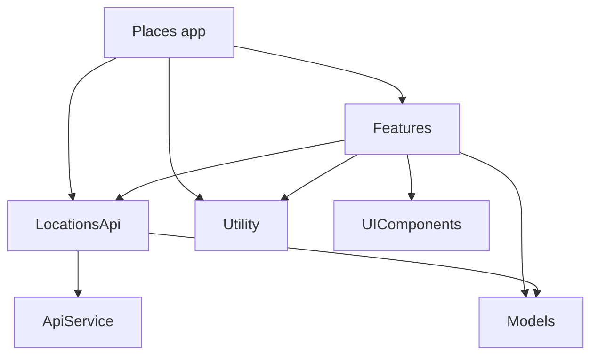

Places
--
Thanks for sending me the assignment.

**Note: Please use Xcode 27+ to run the project (deployment target iOS 26.5).**

For this assignment, I developed the "Places" app, which fetches a list of locations from the given API and displays them in a list. Some locations in the API response don't have a name, so the app uses reverse geocoding to look up and show the city name for those coordinates. The list supports pull to refresh and shows dedicated loading, empty and error states with a retry action.


**📦 Internal packages dependency structure:**



#### In this project:
- To ensure the app structure is scalable, I implemented a modular architecture by dividing the app into multiple Swift Package Manager (SPM) packages. These include the main target, Features, UIComponents, Locations API, API Service, Models and Utility:
  - **Main target:** Contains the app and scene delegates, assets, and composes the dependencies for the first screen.
  - **Features:** Contains feature-specific implementations, such as the Locations screen.
  - **UIComponents:** Hosts reusable UI components, such as the location cell and its view model.
  - **Locations API:** Manages location-related REST APIs, such as fetching locations.
  - **API Service:** Handles API consumption and is designed for easy expansion in the future.
  - **Models:** Stores networking models and data structures.
  - **Utility:** Hosts shared services, such as the reverse geocoder that resolves city names with MapKit and caches them per coordinate.
- **Benefits of this structure:**
  - In medium to large sized teams, modularity reduces merge conflicts in the project file when working on new features.
  - Build times are significantly faster because changes made to a specific package only require that package to be rebuilt, while the rest of the packages remain cached. This not only enhances development efficiency but also reduces CI runtime, which can save costs over time by minimizing resource usage.
- Developed the UI using `UIKit`, built in code without storyboards.
- Followed the `VIPER` architecture: each screen has a `Component` that assembles it and a `Contract` that defines the protocols between the view, presenter, interactor and router.
  - The **view** only renders what the presenter tells it and forwards user actions.
  - The **presenter** holds the presentation logic, such as formatting coordinates and choosing the empty and error states.
  - The **interactor** holds the business logic, such as fetching the locations and resolving missing names.
  - The **router** handles navigation.
- Used constructor injection for all dependencies, so every module can be tested with mocks.
- Used `Async-Await` for networking and reverse geocoding.
- Used `MapKit` reverse geocoding to resolve the city name of unnamed locations. The list is shown immediately and updated once the city names are resolved.
- Created an `ApiService` actor to handle API consumption, with scalability in mind for future expansion.
- Wrote unit tests using the latest `Swift Testing` framework and added test cases for the features, UI components, utility, Location API, API Service and model layers.
- Added a test plan (`Places.xctestplan`) that runs the tests of the app and all packages together, with code coverage enabled.
- No third-party dependencies are used.


#### ▶️ Running the project:
1. Open `Places.xcodeproj` in Xcode 27+.
2. Select the `Places` scheme and an iOS 26.5+ simulator.
3. Press ⌘R to run the app, or ⌘U to run all tests.

To run the tests from the command line:

```sh
xcodebuild test -project Places.xcodeproj -scheme Places -testPlan Places \
  -destination 'platform=iOS Simulator,name=iPhone 17'
```

#### Screenshot:


